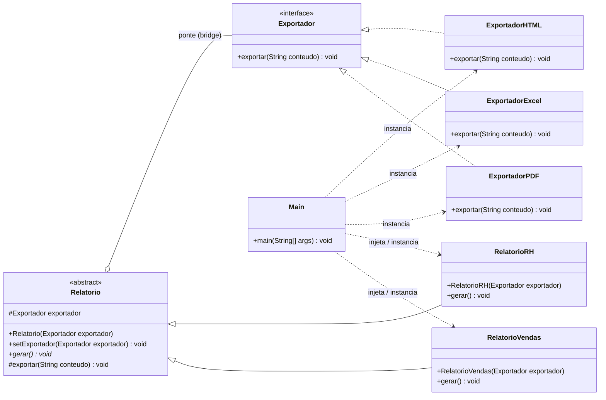
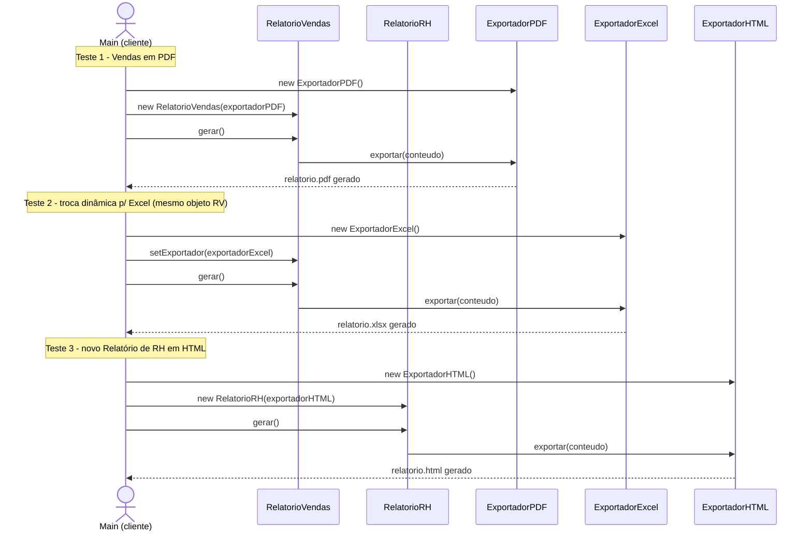

# Sistema de Relatórios BI — TechFatec

**Autores:** Alex Expedito e Matheus Curci

Módulo de exportação de relatórios refatorado com o **Padrão de Projeto Bridge**
(GoF, categoria Estrutural) para permitir que **novos tipos de relatório** e
**novos formatos de exportação** evoluam de forma totalmente independente,
sem gerar explosão de subclasses e respeitando o **Princípio Aberto/Fechado (OCP)**.

## 1. Problema original

O sistema legado só sabia gerar o "Relatório de Vendas" em PDF. Ao surgir o
requisito de exportar também para Excel e HTML, e de incluir um novo
"Relatório de Desempenho de RH", a abordagem ingênua seria criar uma
subclasse para cada combinação (`RelatorioVendasPDF`, `RelatorioVendasExcel`,
`RelatorioVendasHTML`, `RelatorioRHPdf`, ...), crescendo em **M x N**
subclasses a cada novo formato ou novo relatório. O Bridge resolve isso
separando as duas dimensões em duas hierarquias que se comunicam por
composição, não por herança.

## 2. Estrutura de diretórios

```
/src
 ├── abstracao/          -> Hierarquia da Abstração (o "o quê": os relatórios)
 │     ├── Relatorio.java          (classe abstrata / Abstraction)
 │     ├── RelatorioVendas.java    (Refined Abstraction)
 │     └── RelatorioRH.java        (Refined Abstraction - novo requisito)
 │
 ├── implementacao/       -> Hierarquia da Implementação (o "como": os formatos)
 │     ├── Exportador.java         (interface / Implementor)
 │     ├── ExportadorPDF.java      (Concrete Implementor)
 │     ├── ExportadorExcel.java    (Concrete Implementor)
 │     └── ExportadorHTML.java     (Concrete Implementor)
 │
 └── cliente/             -> Ponto de composição e execução
       └── Main.java             (injeta as dependências e valida o desacoplamento)
```

## 3. Por que é um Bridge (e não Strategy ou Factory)

- `Relatorio` **não implementa** `Exportador` nem herda dele: ela mantém uma
  **referência** (`protected Exportador exportador`) — essa composição é a
  "ponte" entre as duas hierarquias.
- As duas hierarquias variam **independentemente**: dá para adicionar
  `RelatorioFinanceiro` sem tocar em nenhum `Exportador`, e dá para adicionar
  `ExportadorCSV` sem tocar em nenhum `Relatorio` (OCP).
- A dependência concreta (`new ExportadorPDF()`, por exemplo) **nunca**
  aparece dentro das classes de `abstracao/`. Ela é sempre criada e
  **injetada pelo cliente via construtor** (`Main.java`), atendendo à
  restrição de Injeção de Dependência exigida no projeto.
- `setExportador(...)` permite trocar o formato de saída **em tempo de
  execução**, no mesmo objeto `Relatorio`, sem recriá-lo — isso é
  exatamente o que o script `Main.java` comprova no Teste 2.

## 4. Diagrama de Classes



## 5. Diagrama de Sequência (os 3 cenários do script de validação)



## 6. Como compilar e executar

Pré-requisito: JDK 17+ instalado (`javac -version`).

```bash
# a partir da raiz do projeto
mkdir -p bin
javac -d bin $(find src -name "*.java")
java -cp bin cliente.Main
```

> Nota de encoding: se os acentos aparecerem como "?" no terminal, rode com
> `LANG=C.utf8 java -cp bin cliente.Main` (isso é só configuração de locale
> do terminal, não afeta o código-fonte, que já está em UTF-8).

Saída esperada (resumida): geração do Relatório de Vendas em PDF, a troca em
tempo de execução do **mesmo objeto** para Excel, e a geração do novo
Relatório de RH em HTML — sem que nenhuma classe de relatório tenha
conhecimento do formato concreto usado.

## 7. Aderência aos requisitos do projeto

| Requisito | Como foi atendido |
|---|---|
| Padrão Bridge | Duas hierarquias (`abstracao` / `implementacao`) ligadas por composição |
| OCP (Aberto/Fechado) | Novo `RelatorioRH` e novos `Exportador*` adicionados sem alterar código existente |
| Proibição de `new` dentro do relatório | `Relatorio` e subclasses só recebem `Exportador` já pronto |
| Injeção via construtor | `RelatorioVendas(Exportador)`, `RelatorioRH(Exportador)` |
| Troca dinâmica em runtime | `setExportador(...)` usado no Teste 2 sobre o mesmo objeto |
| Separação física de diretórios | `/src/abstracao`, `/src/implementacao`, `/src/cliente` |

## 8. Como subir este projeto no GitHub

```bash
git init
git add .
git commit -m "Bridge Pattern: modulo de relatorios PDF/Excel/HTML"
git branch -M main
git remote add origin https://github.com/SEU-USUARIO/NOME-DO-REPO.git
git push -u origin main
```

Lembre-se de deixar o repositório **público** antes de gravar o vídeo de
defesa técnica, e de testar o link em uma **aba anônima** do navegador.
